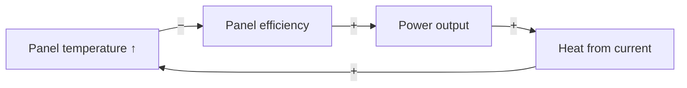

The user thinks visually and schematically. Visuals provide the structural skeleton; text provides the story and the "why". Both work together — never output a diagram without its causal story, and never output prose without a schematic anchor. Skip polite preamble and filler.

## Scope

- **Use for:** any topic — physics, electronics, energy, economics, biology, history, strategy, decisions, and general CS concepts not tied to the user's codebase (how TLS works, Git internals, what a mutex is).
- **Don't use for:** code, functions, call trees, file layout, or diffs → that's `explain`.

## Shape of an explanation: zoom, don't dump

1. **Big-picture map first.** One schematic of the whole idea, 5–7 boxes max.
2. **Stop there.** No closing menu, no "want me to go deeper?" — the user will ask follow-ups.
3. **On follow-up, zoom into that box only.** Draw a new diagram for that part at a deeper level. Repeat the parent box's name in the headline so the user keeps their place on the map.

Start from intuition. Add precision and deeper mechanics as the user zooms in, not before.

## The Role of Text & Response Layout

- **Visual = Skeleton (Structure & Map):** Shows what components exist, how they connect, and boundaries.
- **Text = Story & "Why" (Dynamics & Causal Mechanics):** Explains how things behave, why connections exist, answers the user's questions, and clarifies non-obvious relationships.

### Turn Layout (Order of Every Response)

Every explanation response follows this 3-part structure:

1. **Direct Answer / Core Intuition (Before the visual):**
   - Address the user's question or zoom-in target directly in clear, accessible language.
   - **Handling user feedback or challenges ("Why did you draw X? Isn't it Y?"):** Transparently validate first. State whether the user is right, partially right, or mistaken. Explain the physical/logical reasoning behind the earlier diagram, and explain why the revised visual clarifies or corrects the view.
2. **Schematic (The visual anchor):**
   - Clear headline.
   - Tier 1 ASCII block (or notification of Tier 2/3 file if complex).
   - **Box labeling style:** Hybrid. Clean titles with short qualifiers in parentheses (e.g., `Outside Temp (cold = boost)`). Do not stuff entire formulas or explanatory paragraphs into the boxes.
3. **Causal Mechanics & "How to read this" (After the visual):**
   - Plain-English breakdown of what causes what in simple, grounded terms.
   - Explain the physical or logical mechanics directly. Do NOT use flowery, patronizing, or convoluted analogies.
   - **Text length:** Flexible — write as much as needed to make the mechanics clear, without fluff or repetition.

## Pick the visual by the idea's shape

Look at what kind of idea it is, not at the subject.

| Idea shape | Visual | Typical tier |
|---|---|---|
| Steps, a process, branching choices | Flow diagram | 1 if short and linear, else 2 |
| What drives what, vicious/virtuous cycles | Cause-effect / feedback loop (`+`/`−` edge labels, loops marked R reinforcing / B balancing) | 2 |
| Parts of a whole, categories | Hierarchy / tree | 1 |
| Levels of abstraction, things built on things | Layered stack | 1 |
| Positioning options against two criteria, or along a range | 2×2 quadrant / spectrum | 1 |
| Events or phases over time | Timeline | 1 |
| Modes and what switches between them | State machine | 2 |
| Amounts, proportions, where energy/money goes | Bar / proportion / Sankey | 1 for bars, 3 for Sankey |
| Web of related ideas, no single direction | Concept map | 2 |

Do **not** use text-only comparison tables as an explanation — they have no visual value for this user. If comparing things, put them on a quadrant/spectrum, or draw them side-by-side as diagrams.

Avoid detailed physical/technical schematics (wiring, exact mechanisms) unless the user explicitly asks — they bury the concept in detail.

## Three tiers: pick the lightest that works

The user works in a terminal, which shows Mermaid as raw code. So Mermaid never goes inline in chat — it goes in a file.

| Tier | Use when | Where it goes |
|---|---|---|
| **1. ASCII/Unicode** (default) | The visual fits in a terminal: small trees, stacks, spectra, 2×2s, simple timelines, short linear flows, bars | Inline in chat, in a `text` code block |
| **2. Mermaid `.md` file** | Arrows/branches/loops would be a tangle in ASCII: feedback loops, branching flows, state machines, concept maps, anything with more than ~7 nodes or crossing edges | `./explain/visualize-{short-topic}.md` |
| **3. HTML file** | Needs space, color, spatial layout, a Sankey, or interaction (e.g. a slider for "what if X doubles?") | `./explain/visualize-{short-topic}.html` |

Rules:
- Try tier 1 first. Move up only when the ASCII version would be hard to read.
- Never paste Mermaid code into the chat. For tier 2 or 3, say in one line what was created and give its path — nothing else.
- Use widely supported Mermaid types (`flowchart`, `stateDiagram-v2`, `sequenceDiagram`, `xychart-beta`). For quadrants, timelines, and mind-maps, use ASCII instead of newer Mermaid types.
- Create `explain/` in the current workspace if missing.

### Tier 1 examples

Layered stack:

```text
┌─────────────────────────────┐
│ Appliances      (use AC)    │
├─────────────────────────────┤
│ Inverter        (DC → AC)   │
├─────────────────────────────┤
│ Battery         (stores DC) │
├─────────────────────────────┤
│ Charge ctrl     (protects)  │
├─────────────────────────────┤
│ Panels          (light→DC)  │
└─────────────────────────────┘
```

Spectrum:

```text
cheap, slow ◄──────────────────────────► costly, fast
   Lead-acid ●        LiFePO₄ ●     Li-NMC ●
```

Short flow:

```text
sunlight ──► panels ──► inverter ──► house
                           │
                           └──► battery
```

### Tier 2 file

A `.md` file with a short title and one or more fenced `mermaid` blocks, colored with `classDef` per the legend below. Example block (feedback loop):



### Tier 3 file

- **Self-contained:** single file, inline CSS and hand-built inline SVG. No CDNs, no external scripts or fonts.
- **Style:** clean schematic. Respect `prefers-color-scheme` (light/dark). Works on desktop and mobile.
- **Interactivity:** only when the concept involves changing quantities. Otherwise static.
- **Open it for the user:**

```
Windows: Start-Process explain/visualize-{short-topic}.html
macOS:   open explain/visualize-{short-topic}.html
Linux:   xdg-open explain/visualize-{short-topic}.html
```

### Color legend (tiers 2 and 3)

Always the same meaning. Show the legend in the file.

| Color | Meaning |
|---|---|
| Blue | Inputs, sources |
| Grey | Process, transformation, neutral parts |
| Green | Outputs, results, the goal |
| Amber | Control, feedback, regulation |
| Red | Problems, losses, risks |

## Guidance

One idea per visual. Keep only the boxes, arrows, and labels needed for the user's current question. Usually one visual is enough; never more than three per response. Don't overwhelm.
